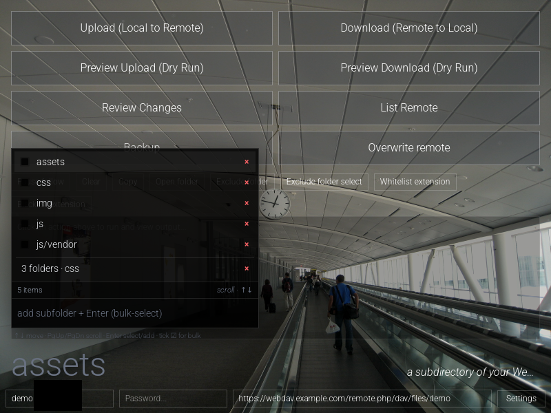

# scs-rclient

Native WebDAV desktop client




## Installation

### Install on Windows

Grab the installer from the [latest release](https://github.com/anthony1x6000/scs-rclient/releases/latest): download `scs-rclient-win-installer.exe` and run it.

### Install from Flatpak repository

With the Flatpak repository, you get automatic updates whenever a new version is released.

Ensure Flathub and the scs-rclient repository are added:

```bash
# Add Flathub for runtime dependencies
flatpak remote-add --if-not-exists --user flathub https://dl.flathub.org/repo/flathub.flatpakrepo

# Add scs-rclient repository
flatpak remote-add --if-not-exists --user scs-rclient https://anthony1x6000.github.io/scs-rclient/online.anthonyis.scs-rclient.flatpakrepo
```

Install:

```bash
flatpak install --user scs-rclient online.anthonyis.scs-rclient
```

With the repo added, you can check for updates with:

```bash
flatpak update
```

### Install the standalone .flatpak (no repository)

```bash
flatpak install --user https://github.com/anthony1x6000/scs-rclient/releases/latest/download/scs-rclient-linux.flatpak
```

## Run the app

```bash
flatpak run online.anthonyis.scs-rclient
```

## Default permissions (Flatpak build only)

> These apply to the Flatpak build, which runs sandboxed. The native packages
> below (AppImage, DEB, RPM, NSIS/portable EXE) run with full user privileges.

- `~/Documents/scs-rclient` (create)
- Secret Service / Keyring (`org.freedesktop.secrets`, `org.freedesktop.portal.Secret`, `org.kde.kwalletd5/6`)
- Network access (`--share=network`)
- Display server access (X11 & Wayland), GPU (`--device=dri`) + IPC (`--share=ipc`)
- `WEBKIT_DISABLE_DMABUF_RENDERER=1` env workaround

If you need access to other directories for file synchronization, use [Flatseal](https://flathub.org/en/apps/com.github.tchx84.Flatseal) or grant a specific folder:

```bash
# Grant access to Documents folder
flatpak override --user --filesystem=~/Documents online.anthonyis.scs-rclient
```

> Avoid `flatpak override --filesystem=host`: it exposes your entire home
> directory to the app. Prefer per-folder grants.

## Other release packages

Standalone release binaries are also available from [GitHub Releases](https://github.com/anthony1x6000/scs-rclient/releases/latest):
- **Linux**: AppImage, DEB, RPM, Flatpak
- **Windows**: Portable EXE, Icon-free portable EXE, Installer EXE

## Security

This project is audited with the [Cloudflare security-audit skill](https://github.com/cloudflare/security-audit-skill). Confirmed findings are fixed before the release that ships them. Recent passes hardened WebDAV listing and download handling against hostile or compromised servers (cancel- and deadline-bounded listing bodies, bounded derived folder state, and capped local path depth), and bounded the metadata and listing cache read from those servers (checked date and size arithmetic, a byte-capped cache read, and fail-closed cache entries).

Windows portable builds are scanned with VirusTotal before release, and the verdict is appended to the release notes.

To report a vulnerability, use [GitHub security advisories](https://github.com/anthony1x6000/scs-rclient/security/advisories/new) instead of a public issue.
